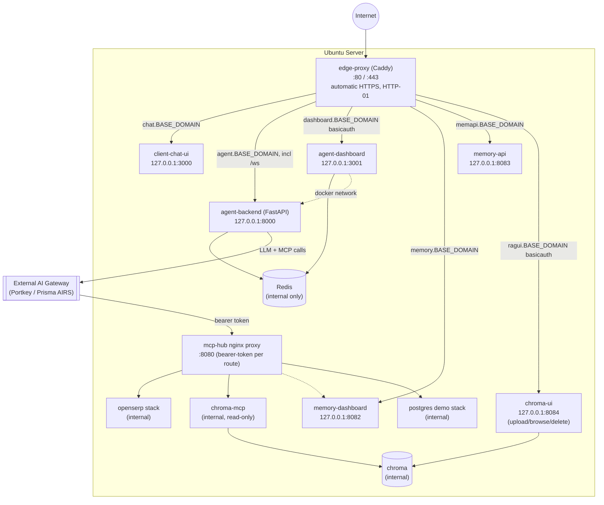

# All-in-a-Box Architecture

Consolidating `my-ai-agent` (chat client + backend agent + admin dashboard) and
`my-mcp-tools` (MCP hub) from 3 separate Ubuntu servers onto **1 Ubuntu server**,
keeping each component as its own independently-deployed Docker Compose
project, differentiated by **localhost port**, fronted by a **single shared
edge reverse proxy** (`edge-proxy/`). A single `install.sh` at the repo root
brings up a brand-new Ubuntu server end to end — see §6.

> Scope note: the two source folders actually contain **4 deployable
> component groups**, not 3 — see [Components found](#1-components-found-vs-instructiontxt).

---

## 1. Components found vs. instruction.txt

| instruction.txt calls it | Actual project | Notes |
|---|---|---|
| chat client | `my-ai-agent/client-chat-ui` | Next.js, no DB, talks to backend over HTTP/WS |
| backend agent | `my-ai-agent/agent-backend` | FastAPI + Redis |
| *(not mentioned)* | `my-ai-agent/agent-dashboard` | Next.js admin UI, bundled into `agent-backend`'s compose stack, shares its Docker network |
| mcp tools | `my-mcp-tools/mcp-hub` | nginx proxy + 4 independent sub-stacks: `openserp`, `chroma`, `memory`, `postgres` |

The admin dashboard rides along with the backend agent and needs no separate
migration decision.

**RAGFlow has been replaced with Chroma**
(`my-mcp-tools/mcp-hub/servers/chroma/`): three containers — `chroma` (the
vector DB), `chroma-mcp` (a hand-written, read-only MCP server mirroring the
hub's own `memory/mcp/` convention), and `chroma-ui` (a standalone upload/
browse/delete web app, independent of the MCP server and of `mcp-proxy`,
reachable at `ragui.{BASE_DOMAIN}`). No shared Elasticsearch/MySQL/MinIO, no
dependency on any other container in the hub, and no AI Gateway call needed
for retrieval or ingestion (Chroma's default embedding function runs locally
in both `chroma-mcp` and `chroma-ui`). The MCP server is deliberately
read-only — ingestion and deletion only happen through `chroma-ui` — so an
agent can search the knowledge base but can't corrupt or wipe it. This swap
also removed RAGFlow's 8-32GB resource footprint and the Elasticsearch
kernel-tuning requirement entirely.

Still assumed: the backend agent and the MCP hub route all LLM/embedding
calls through an external **Portkey/Prisma AIRS AI Gateway**, which stays
external (cloud or another host) and is *not* part of this consolidation.
Several configs hardcode its LAN IP (`192.168.110.161`) — if the new server
isn't on the same network as that gateway, those need updating; this is the
one open item left (see §7).

---

## 2. Target topology

Four independent Docker Compose projects, matching the existing isolation
design in `my-ai-agent/CLAUDE.md` ("no shared network with the backend
stack") — just co-located on one box instead of three, with **one** edge
proxy replacing the two that used to fight over ports 80/443:

1. `client-chat-ui/` — own compose project, own network
2. `agent-backend/` — own compose project, own network (dashboard shares it, as today)
3. `mcp-hub/` — own compose project, own network, untouched except the chroma swap + memory port rebinds
4. `edge-proxy/` — **new**, the single public entry point (`network_mode: host`, reaches the others via their `127.0.0.1:<port>` bindings)

---

## 3. Port plan

Everything except `edge-proxy` and the MCP hub's nginx binds to
**`127.0.0.1`**, not `0.0.0.0` — Docker's published ports bypass UFW, and two
unrelated stacks each owning `80/443` was the reason they couldn't coexist.

| Service | Container port | Host bind |
|---|---|---|
| **edge-proxy (Caddy)** | 80/443 | `0.0.0.0:80`, `0.0.0.0:443` (`network_mode: host`) |
| client-chat-ui: `chat_ui` | 3000 | `127.0.0.1:3000` |
| agent-backend: `agent` | 8000 | `127.0.0.1:8000` |
| agent-backend: `redis` | 6379 | unpublished (internal only) |
| agent-backend: `dashboard` | 3000 | `127.0.0.1:3001` |
| mcp-hub: `proxy` (nginx) | 8080 | `0.0.0.0:8080`, IP-restricted to the AI Gateway via `DOCKER-USER` |
| mcp-hub: `openserp` debug | 7000 | `127.0.0.1:7000` |
| mcp-hub: `chroma` / `chroma-mcp` | — | unpublished (internal only — MCP, read-only, via proxy) |
| mcp-hub: `chroma-ui` | 8084 (container 8000) | `127.0.0.1:8084` |
| mcp-hub: `memory-api` | 8083 (container 8000) | `127.0.0.1:8083` |
| mcp-hub: `memory-dashboard` | 8082 (container 3000) | `127.0.0.1:8082` |
| mcp-hub: everything else | — | unpublished (internal only) |

---

## 4. Domain & TLS

Switched from acme-dns (DNS-01, needed a one-time manual account registration
+ per-hostname CNAME) to **Caddy's standard automatic HTTPS (HTTP-01)** —
confirmed as the better fit for an automated installer: zero extra
credentials, Caddy issues and renews certs on its own as long as each
hostname's DNS A record points at the server and ports 80/443 are reachable.

`edge-proxy/Caddyfile` is parameterized entirely by environment variables
(`{$BASE_DOMAIN}`, `{$ACME_EMAIL}`, `{$DASHBOARD_USER}`,
`{$DASHBOARD_PASSWORD_HASH}`, `{$MCP_UI_USER}`, `{$MCP_UI_PASSWORD_HASH}`),
sourced from `edge-proxy/.env`. Changing the domain later is a one-line edit
(or re-running `install.sh`), not a multi-file find/replace.

Public hostnames (all under one `BASE_DOMAIN`, set once at install time):

| Hostname | Routes to | Notes |
|---|---|---|
| `chat.{BASE_DOMAIN}` | `client-chat-ui` | |
| `agent.{BASE_DOMAIN}` | `agent-backend` | standard 443 now, dropped the old nonstandard `:8443` |
| `dashboard.{BASE_DOMAIN}` | `agent-dashboard` | Caddy `basicauth`, same convention as before |
| `memory.{BASE_DOMAIN}` | `memory-dashboard` | **newly public** per requirement — previously LAN-only |
| `memapi.{BASE_DOMAIN}` | `memory-api` | needed because the dashboard's browser JS calls this API directly by hostname, not just server-side |
| `ragui.{BASE_DOMAIN}` | `chroma-ui` | Caddy `basicauth`, separate credential from the admin dashboard's (different trust boundary: mcp-hub vs. agent-backend) |

---

## 5. Code/config changes made

1. Removed the Caddy sidecar from both `client-chat-ui/docker-compose.yml`
   and `agent-backend/docker-compose.yml` (and their `Caddyfile`/`Dockerfile.caddy`).
   Rebound `chat_ui` → `127.0.0.1:3000`, `agent` → `127.0.0.1:8000`,
   `dashboard` → `127.0.0.1:3001`; `redis` no longer publishes a host port.
2. Added `edge-proxy/` (compose + Caddyfile) as the single shared entry point
   (§2, §4).
3. `agent-backend`'s `dashboard.NEXTAUTH_URL` and `client-chat-ui`'s
   `NEXT_PUBLIC_AGENT_BASE_URL`/`NEXTAUTH_URL` now resolve from `BASE_DOMAIN`
   instead of a hardcoded domain.
4. `mcp-hub`: replaced the RAGFlow include with `servers/chroma/` (`chroma`,
   `chroma-mcp`, `chroma-ui`); added the `/chroma/mcp` route template (same
   bearer-token pattern as every other route — `scripts/deploy.sh`'s existing
   token-bootstrap loop picks it up automatically). Rebound
   `memory-api`/`memory-dashboard` to `127.0.0.1` and parameterized their
   previously-hardcoded LAN-IP env vars (`NEXT_PUBLIC_API_URL`,
   `DASHBOARD_URL`) with `BASE_DOMAIN`.
5. `edge-proxy/Caddyfile` adds a `ragui.{BASE_DOMAIN}` site block (Caddy
   `basicauth`, like `dashboard.{BASE_DOMAIN}`) for `chroma-ui`.
6. `install.sh` (repo root) writes all of the above `BASE_DOMAIN`-derived
   values into each project's `.env`, sets up the firewall, and brings every
   stack up in order — see §6.

No application code changes were needed — only compose files, the Caddyfile,
env files, and firewall config.

---

## 6. `install.sh`

Run once on a brand-new Ubuntu 22.04/24.04 server (after copying this whole
folder over, e.g. via `rsync`/`scp`, same as `mcp-hub-guide.md` already
describes). Safe to re-run — it's idempotent.

1. **Prerequisites**: checks for Docker Engine + Compose plugin (≥ v2.20,
   needed for `mcp-hub`'s `include:`), curl, openssl, ufw, iptables-persistent;
   installs only what's missing; adds the current user to the `docker` group
   if needed.
2. **Prompts for everything**, not just infrastructure: base domain, Let's
   Encrypt contact email, dashboard admin username/password, the `chroma-ui`
   admin username/password, the AI Gateway's source IP (for the mcp-hub
   firewall rule) — **and** every business secret: Portkey gateway URL/API
   key/MCP gateway URL/server slugs, `BASIC_AUTH_USERS`, CyberArk Identity
   (Idira) issuer/audience/JWKS URI/chat client ID+secret, and the AI Gateway
   API key for mem0's `~/mcp-secrets/memory.env`. `NEXTAUTH_SECRET` is
   generated per app instead of prompted (it's a local signing key, not a
   credential that has to match anything external). Re-running shows prior
   answers as defaults (passwords/keys show no default, just "leave blank to
   keep the existing one"); still-empty required values get a warning printed
   at the end rather than blocking.
3. **Writes `.env` files** for `edge-proxy`, `agent-backend`, `client-chat-ui`,
   and `mcp-hub`, plus `~/mcp-secrets/{memory,postgres}.env` (the latter two
   get random passwords generated locally — only the AI Gateway key for
   `memory.env` is actually asked for, defaulting to the Portkey key already
   entered). `~/mcp-secrets/hub.env` is still handled by `mcp-hub`'s own
   `scripts/deploy.sh`, unchanged.
4. **Firewall**: `ufw` allows SSH/80/443; the MCP hub's port 8080 is
   restricted to the AI Gateway's IP via the `DOCKER-USER` iptables chain
   (Docker-published ports bypass `ufw` itself).
5. **Brings everything up**, in order: `mcp-hub` (via its own
   `scripts/deploy.sh`, reusing its existing token-bootstrap/smoke-test
   logic), `agent-backend`, `client-chat-ui`, then `edge-proxy`.
6. **Prints a summary**: the 6 public hostnames to point DNS at.

A companion non-interactive `deploy.sh` redeploys all four stacks using
whatever config `install.sh` already wrote — this is what GitHub Actions runs
on every push. See `DEPLOYMENT.md` for the full CI/CD setup (self-hosted
runner on the Ubuntu box, same pattern `my-mcp-tools` already uses for itself).

---

## 7. Open items

1. **AI Gateway location.** Several configs hardcode its LAN IP
   (`192.168.110.161`); confirm the new server will be on the same network,
   or update those values. This is the only genuinely open architectural
   question left.
2. **Chroma footprint is an estimate** (§8) until real usage confirms it —
   it's categorically much lighter than RAGFlow (no ES/MySQL/MinIO), but
   hasn't been load-tested here.
3. **No original-file storage in `chroma-ui`.** Uploads are parsed to text,
   chunked and embedded, but the original binary isn't kept (no MinIO) — a
   known trade-off for staying standalone. If retrieving/downloading the
   original file later turns out to matter, that needs object storage added.
4. **`NEXT_PUBLIC_AGENT_BASE_URL` build-time vs runtime.** It's read via
   `process.env` with no Dockerfile build-arg wiring, which only works if
   it's consumed server-side (consistent with CLAUDE.md's note that TLS
   verification to the backend is disabled, which can't happen in-browser).
   Smoke-test after deploy — if the browser calls the old domain, this needs
   to become a build-arg instead.

---

## 8. System requirements (single Ubuntu server)

With RAGFlow gone, nothing here dominates the way RAGFlow used to — Chroma's
embedded index is the only piece that grows meaningfully with usage, and it's
far lighter than Elasticsearch+MySQL+MinIO.

| Component | vCPU | RAM | Storage | Source |
|---|---|---|---|---|
| agent-backend + Redis | 1 | 2 GB | 5 GB | inferred (FastAPI + Redis, light) |
| client-chat-ui | 0.5 | 0.5 GB | 2 GB | inferred (Next.js, no DB) |
| agent-dashboard | 0.5 | 0.5 GB | 2 GB | inferred (Next.js, no DB) |
| edge-proxy (Caddy) | 0.25 | 0.25 GB | 1 GB | inferred |
| mcp-hub nginx proxy | 0.25 | 0.25 GB | 1 GB | inferred |
| openserp + headless Chrome | 1 | 2 GB (+2 GB `shm`) | 5 GB | documented `shm_size: 2gb` requirement |
| chroma + chroma-mcp | 0.5–1 | 1–2 GB | 5–15 GB, grows with corpus size | estimate — no shared ES/MySQL/MinIO, local embedded index |
| chroma-ui | 0.25 | 0.25–0.5 GB | 1 GB | estimate — FastAPI, no state of its own beyond the `chroma` container; duplicates the ~80MB embedding model download |
| memory stack (mcp + api + dashboard + pgvector) | 1 | 2–4 GB | 10–20 GB, grows with embeddings | inferred |
| postgres demo stack | 0.5 | 0.5 GB | 2 GB | documented as deliberately lightweight (≤10 conns, 15s timeout) |
| OS + Docker overhead + headroom | 1 | 2 GB | 20 GB | rule of thumb |

### Recommendation

| Tier | vCPU | RAM | Storage |
|---|---|---|---|
| **Recommended** | **6** | **12 GB** | **70–100 GB SSD** |
| Bare minimum | 4 | 8 GB | 50 GB |

Notes:
- Storage should still be SSD — Postgres (×2: memory + demo) and Chroma's
  index both do real disk I/O, just at a much smaller scale than before.
- If Chroma's document corpus turns out to be large, storage is the figure
  most likely to need revisiting — CPU/RAM scale much more slowly with usage.
- No Elasticsearch kernel tuning (`vm.max_map_count`) is needed anymore.

---

## 9. Migration checklist

- [ ] Provision the new Ubuntu server per §8 sizing
- [ ] Copy this whole project folder onto the server (`rsync`/`scp`)
- [ ] Have the business secrets on hand (Portkey gateway URL/API key, CyberArk
      Identity issuer/audience/JWKS URI/chat client ID+secret, an AI Gateway
      API key for mem0) — `./install.sh` prompts for all of them, nothing to
      pre-edit in `.env` files by hand
- [ ] Run `./install.sh`, answer the prompts (domain, ACME email, dashboard
      credentials, chroma-ui credentials, AI Gateway source IP, business
      secrets above)
- [ ] Point DNS A records for all 6 hostnames at the server's IP
- [ ] Smoke test: TLS issues cleanly on all 6 hostnames; chat UI login +
      message round-trip; dashboard login + live-config write; each MCP
      route's bearer-token check (`mcp-hub/scripts/deploy.sh` already covers
      this, now including `/chroma/mcp`); memory dashboard loads over
      `https://memory.{domain}` and its browser calls succeed against
      `https://memapi.{domain}`; create a collection in `chroma-ui`, upload a
      test file, confirm `chroma_query` via MCP returns it, then delete it
- [ ] Decommission the three old servers once verified
