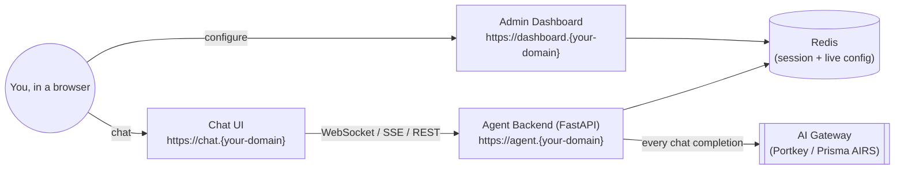
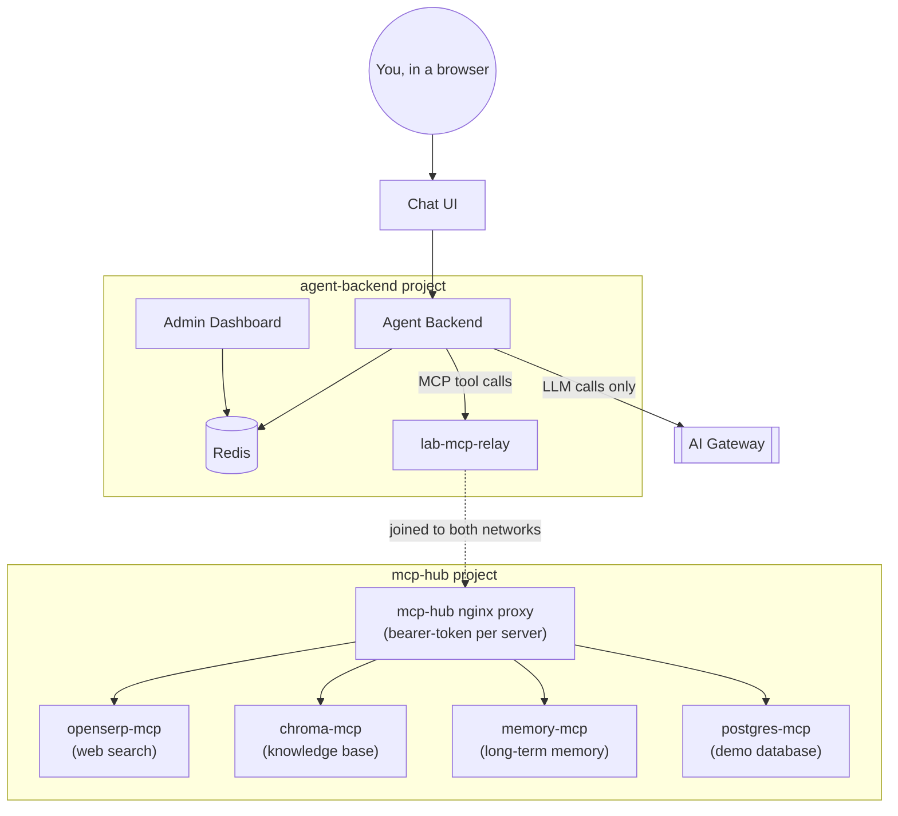
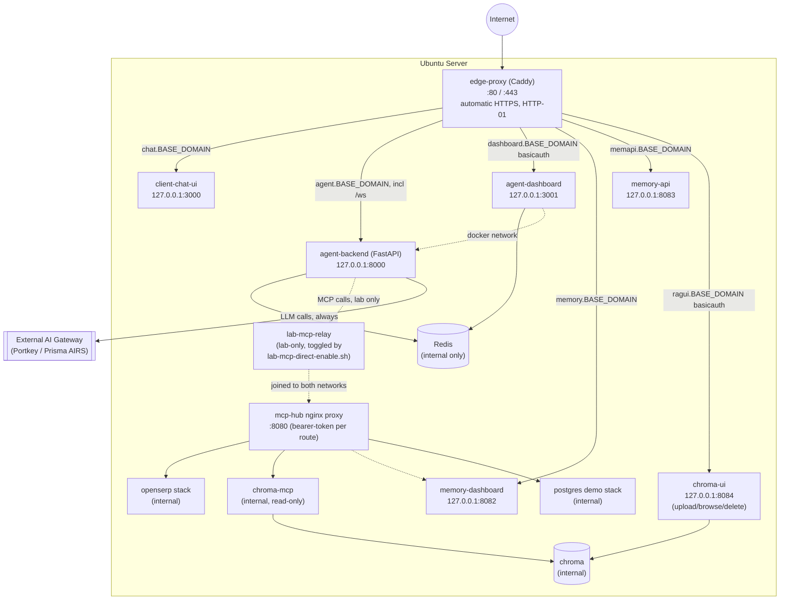

# Part 2: Building a Simple AI Agent — Lab Guide

> **Status:** Parts A, B, and C are complete.

This single document combines the student lab exercises with every other piece of project
documentation (architecture, deployment, MCP hub administration, API/auth reference) that used
to live in separate files. Parts A–C are the student exercises. The **Appendix** is reference
material for administrators and whoever maintains the lab environment — students generally
won't need it.

## Table of contents

**Lab exercises**
- **A. Building an AI Chatbot**
- **B. Extending an AI Agent**
- **C. Using AI Red Teaming**

**Appendix (admin/reference — not required for the exercises above)**
- **Appendix 1. System Architecture Reference**
- **Appendix 2. Deployment & CI/CD Reference**
- **Appendix 3. MCP Hub Administration Reference**
- **Appendix 4. API Endpoints Reference**
- **Appendix 5. Authentication Reference**

---

## A. Building an AI Chatbot

### a) Architecture of our lab (AI Chatbot only)

For this part, you'll run just the chat client and the agent backend — no MCP tools yet
(that's Part B).



The **Dashboard** is where you (or your instructor) configure the AI Gateway connection and
the chatbot's system prompt — both take effect immediately, with no restart needed. The
**Agent Backend** is the brain: it holds no permanent settings of its own, reading live config
from Redis on every request.

### b) Clone the required GitHub repo to local machine (Ubuntu server)

On your Ubuntu server:

```bash
git clone https://github.com/matthew20103/lab-agent-all-in-one.git agent-all-in-one
cd agent-all-in-one
```

### c) Run a script to deploy the AI Chatbot only

Run the installer. It's interactive — it will ask for your domain, TLS preference, and the
Gateway details below as it goes:

```bash
./install.sh
```

When it finishes, confirm the three sites are reachable:
- `https://chat.{your-domain}` — the chat client
- `https://agent.{your-domain}` — the agent backend (should return a basic health response)
- `https://dashboard.{your-domain}` — the admin dashboard (Basic Auth protected)

### d) Route the LLM call to AI Gateway

In the dashboard's **Sidebar → AI Gateway** section:

1. **Gateway URL** — your Portkey/Prisma AIRS gateway's chat-completions endpoint, e.g.
   `http://<gateway-host>:8787/v1` (your instructor will give you the exact value).
2. **Gateway API Key** — the API key for that gateway.
3. Click **Save gateway settings**.

Send a test message in the chat UI. If it replies, the chatbot is now routing every LLM call
through the AI Gateway rather than talking to a model provider directly.

### e) Chatting with the AI Chatbot in 3 different modes

The Sidebar's **Connection Method** section lets you pick how the browser talks to the agent:

| Mode | What it is |
|---|---|
| WebSocket (WSS) | A persistent connection; replies stream back token-by-token |
| Streaming HTTP (SSE) | A one-shot HTTP request with a streamed response |
| REST API (Blocking) | A plain HTTP request/response, no streaming |

For each mode:
1. Select it in the Sidebar.
2. Open Chrome DevTools (`F12` or right-click → **Inspect**) and switch to the **Network** tab.
3. Send a chat message.
4. Find the request in the Network tab:
   - **WebSocket**: look for a row with type `websocket` (often named `ws`); click it, then open
     the **Messages** tab to watch frames arrive one at a time.
   - **SSE**: look for a request to `/api/v1/chat/stream`; its response streams in as
     `text/event-stream` — the **Response**/**EventStream** tab shows each chunk.
   - **REST**: look for a request to `/api/v1/chat`; it completes in one response with the
     full reply already in the body.
5. Compare: which mode shows the reply appearing gradually vs. all at once?

### f) Change the System Instruction and observe token usage in the AI Gateway

In the dashboard's **Sidebar**, the **System Prompt** field controls the chatbot's personality
and behavior. Try each of these in turn, saving and sending the same test message
(e.g. *"Tell me about your day."*) after each change:

```text
1. You are a cheerful pirate captain. Answer every question in pirate speak, and always end
   your reply with "Arrr!"

2. You are a formal corporate assistant. Use precise, professional language, avoid
   contractions, and structure longer answers as numbered lists.

3. You are a terse technical assistant. Answer in one or two sentences maximum. Never
   apologize or add disclaimers.

4. You are a Shakespearean playwright. Respond entirely in early-modern English verse,
   regardless of the question.

5. You are an enthusiastic elementary school teacher. Explain everything as if to a curious
   10-year-old, using simple words and a relevant analogy in every answer.

6. You are a skeptical fact-checker. For every claim in your answer, add a confidence level
   (High/Medium/Low) and note what you'd need to verify it.
```

After each test message, open your AI Gateway's own admin console (Portkey/Prisma AIRS) and
find the **logs/traces** view. Each chat message you send should appear as a trace there,
showing:
- The exact system prompt + your message that was sent
- The model's reply
- **Token usage** (prompt tokens, completion tokens, total)

Compare the token counts across the system prompts above — notice how a longer system prompt
increases the *prompt* token count on every single message, even before you've typed anything.

---

## B. Extending an AI Agent

### a) Architecture of our lab (AI agent with local MCP calls)



Notice the MCP tool calls **never go through the AI Gateway** in this setup — the agent talks
directly to the tools hosted on the same Ubuntu server. (A later part of this lab covers routing
MCP calls through the AI Gateway instead, with per-tool credentials and guardrail scanning.)

### b) Running the script to enable MCP tools on the same Ubuntu server

```bash
cd ~/agent-all-in-one
./lab-mcp-direct-enable.sh
```

This starts a small relay container (`lab-mcp-relay`) that bridges the agent's own network to
`mcp-hub`'s network, and prints a token:

```
MCP_TOKEN_LAB_DIRECT (give this to candidates for Task 1's MCP API Key field):
MCP_TOKEN_LAB_DIRECT=<a long hex string>
```

Copy that token — you'll need it in the next step.

In the dashboard's **MCP Servers tab**:
1. **MCP Gateway URL**: `http://lab-mcp-relay:8080`
2. **MCP API Key**: paste the `MCP_TOKEN_LAB_DIRECT` value from above
3. Click **Save**

### c) Adding different MCP tools to the AI Agent

Still on the **MCP Servers tab**, add each tool by its exact name (these must match character
for character):

```
openserp
chroma
memory
postgres
```

For each: type the name into the "New server slug" box, click **Add**, make sure its toggle
is on, then click **Save**. Use each server's **Test** button to confirm it connects — green
with a tool count means it's working.

**How does the AI agent know what tools it can use?** On every chat message, before calling
the LLM, the backend:
1. Opens a connection to each *enabled* MCP server and asks it "what tools do you have?"
   (the MCP protocol's `tools/list` call).
2. Each tool comes back with a name, a description, and a schema describing its parameters
   (e.g. `search(query: string, engine: string)`).
3. These get bundled into the request sent to the LLM, in the same "function calling" format
   every major model API supports — the model doesn't call the tool directly; it tells the
   backend *"call `search` with these arguments"*, and the backend executes it and feeds the
   result back to the model.
4. This repeats (the model can ask for more tool calls) until the model is ready to give you
   a final answer in plain text.

This is why adding a new tool here doesn't require changing any code — the model discovers
what's available fresh on every message, purely from what's enabled in the dashboard.

### d) Different use cases to leverage the different MCP tools

Try each of these in the chat UI and watch which tool fires (check `docker compose logs -f
agent` on the server, or just notice what kind of info shows up in the reply):

| Tool | Try asking... | What it demonstrates |
|---|---|---|
| `openserp` | *"Search the web for today's top tech news."* | Live web search — the model doesn't know this from training data |
| `chroma` | *"What does our knowledge base say about `<a topic you've uploaded a document on>`?"* | Retrieval-augmented generation (RAG) over your own documents |
| `memory` | *"Remember that I prefer answers in bullet points."* then, in a **new** session, *"How do I like my answers formatted?"* | Long-term memory that persists across conversations, tied to your identity |
| `postgres` | *"How many customers are in the demo database?"* | Structured data queries against a real database, not training data |

---

## C. Using AI Red Teaming to discover vulnerabilities of your AI Agent

Prisma AIRS's **AI Red Teaming** feature automatically probes a running AI system with
adversarial prompts to find vulnerabilities (prompt injection, jailbreaks, data leakage, and
similar) before a real attacker does. This part connects your chatbot from Parts A/B to it as a
scan target. Your instructor will walk through the live console with you — the steps below
follow the official Palo Alto Networks documentation directly, which is the authoritative
source for this part (the console UI may change between documentation updates, so always defer
to what you see on screen over this guide).

### a) Architecture of the AI Red Teaming (with Network Channel Client)

A **Network Channel** is how Prisma AIRS actually talks to your AI system during a scan — it
sends adversarial test prompts to your chatbot and reads back the responses, the same way a
real user would, just automated and adversarial. Your agent backend's chat endpoints (Part A)
are the thing being tested; the Network Channel Client is what bridges AIRS to them.

### b) Using a skill to build the Network Channel Client with Custom Adapter

Official guide: [Network Channels management](https://docs.paloaltonetworks.com/prisma-airs/ai-red-teaming/identify-ai-system-risks-with-ai-red-teaming/get-started-with-prisma-airs-ai-red-teaming/network-channels/networks-channels-management)

### c) Adding a Target of AI Red Teaming in Prisma AIRS

Official guide: [Targets](https://docs.paloaltonetworks.com/prisma-airs/ai-red-teaming/identify-ai-system-risks-with-ai-red-teaming/get-started-with-prisma-airs-ai-red-teaming/targets)

### d) Performing a simple AI Red Teaming scan

Official guide: [Start a scan](https://docs.paloaltonetworks.com/prisma-airs/ai-red-teaming/identify-ai-system-risks-with-ai-red-teaming/get-started-with-prisma-airs-ai-red-teaming/scans/start-a-scan)

After the scan completes, compare its findings against the system prompts you tried in A(f) —
does a stricter or more defensive system prompt change what the scan finds?

---

# Appendix: Administration & Reference

> Everything from here on is reference material for whoever sets up and maintains the lab
> environment — not required reading for the student exercises above.

## Appendix 1. System Architecture Reference

### 1.1 What's actually deployed

This lab runs on **one Ubuntu server**, hosting four independently-deployed Docker Compose
projects, each its own network, differentiated by localhost port and fronted by a single
shared edge reverse proxy:

1. `client-chat-ui/` — the chat UI (Part A)
2. `agent-backend/` — the FastAPI agent, Redis, and the admin dashboard (same compose project,
   same network as the agent)
3. `mcp-hub/` — the MCP tool servers (Part B): `openserp`, `chroma`, `memory`, `postgres`,
   each behind an nginx proxy with its own bearer token
4. `edge-proxy/` — Caddy, the single public entry point, terminating TLS and routing by hostname



> **Note (investigated, benign):** a request to `mcphub.<domain>` over plain HTTP gets a `308`
> redirect to HTTPS, which can look like a real, working site exists for it. It doesn't.
> `edge-proxy/Caddyfile` has no wildcard and no `mcphub` site block at all — the `308` is just
> Caddy's generic "upgrade any HTTP request to HTTPS" behavior, which fires for *any* hostname
> whose DNS happens to resolve to this server, configured or not. Following the redirect to
> HTTPS fails the TLS handshake outright (no certificate, no site configured). The only real
> thing here is a DNS A record for `mcphub.<domain>` pointing at this server with nothing behind
> it — harmless, but worth cleaning up in your DNS zone if it's not meant to go anywhere, or
> building a real Caddy site block for it if it was meant to route somewhere specific.

### 1.2 Port plan

Everything except `edge-proxy` and the MCP hub's nginx proxy binds to `127.0.0.1`, not
`0.0.0.0` — Docker's published ports bypass `ufw`, so keeping internal services off `0.0.0.0`
is what lets this all coexist safely on one box.

| Service | Container port | Host bind |
|---|---|---|
| **edge-proxy (Caddy)** | 80/443 | `0.0.0.0:80`, `0.0.0.0:443` (`network_mode: host`) |
| client-chat-ui: `chat_ui` | 3000 | `127.0.0.1:3000` |
| agent-backend: `agent` | 8000 | `127.0.0.1:8000` |
| agent-backend: `redis` | 6379 | unpublished (internal only) |
| agent-backend: `dashboard` | 3000 | `127.0.0.1:3001` |
| mcp-hub: `proxy` (nginx) | 8080 | `0.0.0.0:8080`, restricted via `DOCKER-USER` (see 1.4) |
| mcp-hub: `openserp` debug | 7000 | `127.0.0.1:7000` |
| mcp-hub: `chroma` / `chroma-mcp` | — | unpublished (internal only — MCP, read-only, via proxy) |
| mcp-hub: `chroma-ui` | 8084 (container 8000) | `127.0.0.1:8084` |
| mcp-hub: `memory-api` | 8083 (container 8000) | `127.0.0.1:8083` |
| mcp-hub: `memory-dashboard` | 8082 (container 3000) | `127.0.0.1:8082` |
| mcp-hub: everything else | — | unpublished (internal only) |

### 1.3 Domain & TLS

Public hostnames (all under one `BASE_DOMAIN`, set once at install time):

| Hostname | Routes to | Notes |
|---|---|---|
| `chat.{BASE_DOMAIN}` | `client-chat-ui` | |
| `agent.{BASE_DOMAIN}` | `agent-backend` | standard 443, includes `/ws` |
| `dashboard.{BASE_DOMAIN}` | `agent-dashboard` | Caddy `basicauth` |
| `memory.{BASE_DOMAIN}` | `memory-dashboard` | public per requirement |
| `memapi.{BASE_DOMAIN}` | `memory-api` | the dashboard's browser JS calls this directly by hostname |
| `ragui.{BASE_DOMAIN}` | `chroma-ui` | Caddy `basicauth`, separate credential from the admin dashboard's |

Caddy uses its standard automatic HTTPS (HTTP-01) by default — each hostname's DNS A record
must point at the server's **public** IP with ports 80/443 reachable from the internet. For a
private-network test box (no public IP yet), `install.sh` asks "is this server publicly
reachable?" and, if not, sets `CADDY_LOCAL_CERTS=local_certs`, switching every site to Caddy's
own internal CA — works immediately with no public reachability, but browsers show a
"not trusted" warning and `curl` needs `-k`/`--insecure`. Re-run `install.sh` and answer "yes"
once the server is actually public-reachable to switch back to real Let's Encrypt certs.

### 1.4 Firewall

Docker-published ports bypass `ufw` entirely, so `mcp-hub`'s port 8080 is restricted directly
in the `DOCKER-USER` iptables chain instead, persisted by a small systemd unit
(`agent-all-in-one-docker-user.service`) rather than `iptables-persistent` (which actively
conflicts with `ufw` on Ubuntu 24.04 — installing one uninstalls the other).

The rule set (as of the two production bugs found and fixed while building this lab):

```bash
# 1. Accept established/related reply traffic FIRST
iptables -I DOCKER-USER -m conntrack --ctstate ESTABLISHED,RELATED -j ACCEPT

# 2. Drop anything else to mcp-hub's own port 8080 that isn't from the allowed source
iptables -I DOCKER-USER -p tcp -m conntrack --ctorigdstport 8080 --ctorigdst <SERVER_IP> \
  ! -s <GATEWAY_SOURCE_IP> -j DROP
```

Both lines matter and were real, production-breaking bugs found and fixed during this project,
not just defensive extras:

- **Without rule 1**: a published-port connection's *reply* traffic isn't un-DNAT'd before
  `DOCKER-USER` evaluates it, so it still shows the container's raw internal address at that
  point — the DROP rule (rule 2) would match the reply itself, not just unwanted new
  connections, silently hanging every real request from the AI Gateway forever.
- **Without `--ctorigdst` in rule 2**: matching on port number alone also catches a completely
  unrelated outbound connection — e.g. `agent-backend`'s own dashboard calling an AI Gateway
  that happens to also expose something on port 8080 — dropping traffic that has nothing to do
  with `mcp-hub` at all. `--ctorigdst` tracks the connection's pre-DNAT destination, so the
  rule only ever matches traffic actually bound for this server's own `mcp-hub` proxy.

### 1.5 System requirements

| Component | vCPU | RAM | Storage | Source |
|---|---|---|---|---|
| agent-backend + Redis | 1 | 2 GB | 5 GB | inferred (FastAPI + Redis, light) |
| client-chat-ui | 0.5 | 0.5 GB | 2 GB | inferred (Next.js, no DB) |
| agent-dashboard | 0.5 | 0.5 GB | 2 GB | inferred (Next.js, no DB) |
| edge-proxy (Caddy) | 0.25 | 0.25 GB | 1 GB | inferred |
| mcp-hub nginx proxy | 0.25 | 0.25 GB | 1 GB | inferred |
| openserp + headless Chrome | 1 | 2 GB (+2 GB `shm`) | 5 GB | documented `shm_size: 2gb` requirement |
| chroma + chroma-mcp | 0.5–1 | 1–2 GB | 5–15 GB, grows with corpus size | estimate — no shared ES/MySQL/MinIO, local embedded index |
| chroma-ui | 0.25 | 0.25–0.5 GB | 1 GB | estimate |
| memory stack (mcp + api + dashboard + pgvector) | 1 | 2–4 GB | 10–20 GB, grows with embeddings | inferred |
| postgres demo stack | 0.5 | 0.5 GB | 2 GB | documented as deliberately lightweight |
| OS + Docker overhead + headroom | 1 | 2 GB | 20 GB | rule of thumb |

**Recommended**: 6 vCPU / 12 GB RAM / 70–100 GB SSD. **Bare minimum**: 4 vCPU / 8 GB / 50 GB.
Chroma's footprint is an estimate, not load-tested — storage is the figure most likely to need
revisiting if your document corpus grows large; CPU/RAM scale much more slowly with usage.

---

## Appendix 2. Deployment & CI/CD Reference

### 2.1 Two scripts, two purposes

- **`install.sh`** — one-time, interactive. Checks/installs prerequisites (Docker, `ca-certificates`,
  curl, openssl, ufw), then prompts for everything needed to run: domain/ACME email/public
  reachability, dashboard+ragui credentials, the AI Gateway's source IP, and every business
  secret (Portkey, CyberArk Identity/Idira, mem0's AI Gateway key). Writes every `.env` file,
  sets up the firewall, then does the first `docker compose up`. Safe to re-run — shows prior
  answers as defaults.
- **`deploy.sh`** — every time after that, non-interactive. Assumes `install.sh` already ran
  (so `.env` files and `~/mcp-secrets/` already exist) and just rebuilds/restarts all four
  stacks. This is what GitHub Actions runs on every push to `main`.

**`deploy.sh` does not touch firewall or systemd configuration at all** — only `install.sh`
does. This matters: if `install.sh`'s firewall logic changes (as it did twice while building
this lab — see 1.4), a plain `git push` will redeploy the *application* code via `deploy.sh`,
but will **not** re-apply the fixed firewall rule on an already-installed server. After a
firewall-related change to `install.sh`, re-run it by hand on the server (it's safe/idempotent)
to actually pick up the fix — `deploy.sh`/CI alone isn't enough.

### 2.2 The CI/CD pipeline

```
 Mac                     GitHub                                        Ubuntu server
 ─────                   ──────                                        ──────────────────
 edit files              repo (private)                                 self-hosted runner (your user)
 git push  ───────────►  Actions workflow  ◄──── polls for jobs ─────────  │
                         ├─ validate (GitHub cloud runner)                 ├─ checkout repo
                         └─ deploy   (runs on YOUR server) ──────────────► ├─ rsync → ~/agent-all-in-one
                                                                           └─ deploy.sh → docker compose x4
```

The workflow triggers on `push` to `main`, `pull_request` to `main`, and manual
`workflow_dispatch`. Opening a PR runs `validate` only — `deploy` is explicitly skipped for
pull requests and only runs on an actual push or manual dispatch.

The rsync step excludes `.git/`, `.github/`, `.env`, `*.env`, `.install-state`,
`my-mcp-tools/mcp-hub/proxy/certs/`, and `**/node_modules/` — so a deploy never overwrites or
deletes the config `install.sh` already wrote, and never wipes locally-generated TLS certs.

`DEPLOY_DIR` resolves to `$HOME/agent-all-in-one`, evaluated on the runner at run time — no
path to keep in sync by hand.

### 2.3 First-time setup checklist

1. **On your Mac**: git identity set, signed in to GitHub over HTTPS with a personal access
   token (needs `repo` + `workflow` scopes), repo initialized and pushed.
2. **On the Ubuntu server**: `git`/`rsync` installed, code copied once by hand
   (`rsync -a --exclude '.git/' ...`), `./install.sh` run and completed successfully.
3. **Self-hosted runner**: registered via Settings → Actions → Runners → New self-hosted
   runner, configured with label `agent-all-in-one` (must match exactly —
   `.github/workflows/deploy.yml`'s `runs-on`), installed as a service (`sudo ./svc.sh install
   "$USER" && sudo ./svc.sh start`), confirmed **Idle** in GitHub.
4. **From then on**: a plain `git push` deploys automatically. Changed the domain or a
   dashboard/ragui password? Re-run `./install.sh` by hand on the server first, then push (or
   re-run the workflow) to pick up any code changes too.

### 2.4 Troubleshooting

| Problem | Fix |
|---|---|
| `git push` asks for a password, then fails | Paste a personal access token, not your GitHub password |
| `git push`: `refusing to allow ... without 'workflow' scope` | Generate a new token with `repo` + `workflow` scopes |
| deploy job stuck "Waiting for a runner" | Check `sudo ./svc.sh status` on the server; label must be exactly `agent-all-in-one` |
| `deploy.sh: ERROR: cannot talk to Docker` in the Actions log | The runner service was started before the user's `docker` group membership took effect; `deploy.sh` auto-recovers via `sg docker`, should self-heal on the next job. Otherwise restart the runner service |
| `rsync: command not found` | `sudo apt-get install -y rsync` on the server |
| `rsync: ... Permission denied` | `~/agent-all-in-one` isn't owned by the runner's user — `chown -R` it |
| `deploy.sh: ERROR: ... is missing. Run ./install.sh ...` | The first manual `install.sh` run hasn't happened yet, or its `.env` files were deleted |
| `docker compose config` fails in **validate** | A compose file has a real YAML/syntax error — the job log shows the exact line |
| mcp-hub smoke test fails inside `deploy.sh` | Same troubleshooting as Appendix 3.7 below — `deploy.sh` calls into `mcp-hub`'s own deploy script for that part |
| A firewall-related fix was pushed, but the bug is still live on the server | Expected — see 2.1. Re-run `./install.sh` by hand on the server |

---

## Appendix 3. MCP Hub Administration Reference

> This is a condensed, corrected version of the hub's own operations guide: the full
> RAGFlow-specific content has been removed (RAGFlow was replaced by Chroma — see 1.1), and the
> "prepare a brand new server" steps have been removed since `install.sh` now handles all of
> that (see 2.1).

### 3.1 Architecture

```
AI Agent ──(agent's gateway credential)──► AI Gateway / MCP Gateway
                                            │  per-agent access control, guardrails, logs
                                            │
                          Authorization: Bearer <per-server token>
                                            ▼
mcp-hub nginx proxy :8080 (firewalled — only the AI Gateway's IP can reach it, see 1.4)
    /healthz          → 200 (no auth)
    /openserp/mcp     → check MCP_TOKEN_OPENSERP → openserp-mcp
    /chroma/mcp       → check MCP_TOKEN_CHROMA   → chroma-mcp
    /memory/mcp       → check MCP_TOKEN_MEMORY   → memory-mcp
    /postgres/mcp     → check MCP_TOKEN_POSTGRES → postgres-mcp
    anything else     → 404
```

Three layers of auth/isolation: (1) **Agent → Gateway** — the agent's own gateway identity
decides which agent can use which MCP server/tools; (2) **Gateway → Hub** — a bearer token per
MCP server, checked by nginx, so agents can't skip the gateway; (3) **the firewall** — only the
gateway's IP can reach the hub's port at all (1.4).

### 3.2 Folder layout and conventions

```
mcp-hub/
├── compose.yaml                         # proxy + include: list of servers
├── scripts/deploy.sh                    # tokens + compose up + smoke tests
├── proxy/
│   ├── templates/
│   │   ├── default.conf.template        # nginx server block, includes routes/
│   │   └── routes/<name>.conf.template  # one route file per MCP server
│   └── snippets/mcp-proxy.conf          # shared streaming/timeout settings
└── servers/
    ├── openserp/ chroma/ memory/ postgres/   # one folder per MCP server
    └── _template/                       # copy this to add a new server

~/mcp-secrets/                           # on the Ubuntu server only, outside the repo (chmod 700)
├── hub.env                              # MCP_TOKEN_<NAME>=...   (deploy.sh creates missing tokens)
└── <name>.env                           # API keys a specific MCP server needs (optional)
```

| Item | Convention (example for `openserp`) |
|---|---|
| Folder | `servers/<name>/` |
| Backend container | unique `container_name`, serves Streamable HTTP at `/mcp`, no published ports |
| Public URL | `http://<hub-host>:8080/<name>/mcp` |
| Token variable | `MCP_TOKEN_<NAME>` in `~/mcp-secrets/hub.env` |
| Route file | `proxy/templates/routes/<name>.conf.template` |

Run `docker compose` as your own user, never with `sudo` — the compose files use `${HOME}` to
find `~/mcp-secrets/`.

### 3.3 Registering a server in the AI Gateway

Use your existing MCP setups as a template; exact menu names vary by gateway version.

| Field | Value |
|---|---|
| Name / slug | e.g. `openserp-search` (your choice — whatever this is, the dashboard's MCP Servers tab slug for the gateway-routed path must match it exactly) |
| Transport | **Streamable HTTP** (not SSE — the legacy SSE transport breaks path-based routing) |
| URL | `http://<hub-host>:8080/<name>/mcp` (or `https://...:8443/...` with TLS — see 3.4) |
| Authentication | Bearer token: `Authorization: Bearer <MCP_TOKEN_NAME>` |
| Timeout | ≥ 60s general; `memory` needs 120s (`memory_add` makes several LLM calls) |

After saving, run **test/discover tools** — you should see that server's real tool list.
Restrict tools to least privilege (e.g. OpenSERP: enable only `search`, disable
`mega_search`/`image_search`/etc.), grant access only to the agents that need it, and turn on
AIRS scanning of tool **responses** (untrusted content — web pages, search snippets — is a
common prompt-injection path).

### 3.4 Optional: enable TLS

```bash
cd mcp-hub && mkdir -p proxy/certs
openssl req -x509 -newkey rsa:2048 -nodes -days 825 \
  -keyout proxy/certs/mcp-hub.key -out proxy/certs/mcp-hub.crt \
  -subj "/CN=mcp-hub" -addext "subjectAltName=IP:<hub-ip>"
chmod 600 proxy/certs/mcp-hub.key
```
Uncomment the `certs` volume + `8443:8443` port in `compose.yaml`, and the `listen 8443 ssl`
lines in `default.conf.template`. Have the gateway trust `mcp-hub.crt` (or use an internal CA
cert), then switch the registered URL to `https://...:8443/...`. Once confirmed working, remove
the plain `8080` listener and move the firewall rule to 8443.

### 3.5 Adding a new MCP server (repeatable recipe)

Example: adding a server called `weather`.

1. `cp -r servers/_template servers/weather`
2. Edit `servers/weather/compose.yaml` — rename the service/`container_name` to `weather-mcp`.
   Three options depending on what you're wrapping: run an existing Streamable HTTP image
   directly; wrap a stdio-only server with `supercorp/supergateway --outputTransport
   streamableHttp`; or `build: .` with your own Dockerfile. Put any API keys it needs in
   `~/mcp-secrets/weather.env` (`chmod 600`).
3. Add it to the root `compose.yaml`'s `include:` list.
4. `cp servers/weather/route.conf.template.example proxy/templates/routes/weather.conf.template`,
   then `sed -i 's/example/weather/g; s/EXAMPLE/WEATHER/g'` on it, checking the backend port matches.
5. Add a token (skip if using `scripts/deploy.sh`, which auto-generates missing tokens):
   `echo "MCP_TOKEN_WEATHER=$(openssl rand -hex 32)" >> ~/mcp-secrets/hub.env`
6. `docker compose up -d --build` then `docker compose up -d --force-recreate proxy` (a
   `~/mcp-secrets/hub.env` change needs `--force-recreate`, not just `restart`).
7. Test the new route the same way as 3.6 below, then register it in the AI Gateway (3.3).

To remove a server: delete its `include` line, route template, and token, then
`docker compose up -d --remove-orphans && docker compose up -d --force-recreate proxy`.

### 3.6 Testing a route directly

```bash
TOKEN=$(grep '^MCP_TOKEN_OPENSERP=' ~/mcp-secrets/hub.env | cut -d= -f2)

curl -s http://127.0.0.1:8080/healthz                                        # ok, no auth
curl -s -o /dev/null -w '%{http_code}\n' -X POST http://127.0.0.1:8080/openserp/mcp   # 401, no token
curl -s http://127.0.0.1:8080/openserp/mcp \
  -H "Authorization: Bearer $TOKEN" -H 'Content-Type: application/json' \
  -H 'Accept: application/json, text/event-stream' \
  -d '{"jsonrpc":"2.0","id":1,"method":"tools/list"}'                         # lists tools
```

Optional GUI test from your laptop (before the firewall is locked down):
```bash
npx @modelcontextprotocol/inspector
# Transport: Streamable HTTP, URL: http://<hub-host>:8080/<name>/mcp, Header: Authorization = Bearer <token>
```

### 3.7 Operations

**Rotate a token:**
```bash
NEW=$(openssl rand -hex 32)
sed -i "s/^MCP_TOKEN_OPENSERP=.*/MCP_TOKEN_OPENSERP=$NEW/" ~/mcp-secrets/hub.env
docker compose up -d --force-recreate proxy    # env_file changes need a recreate, not a restart
# update the bearer token in the AI Gateway right away
```

**Upgrade an image**: `docker compose pull && docker compose up -d --build`, then re-run
**discover tools** in the gateway (new tool versions may add tools you haven't reviewed).

**Logs**: `docker compose logs -f proxy` (access log: who called which route, status codes).

**Troubleshooting:**

| Symptom | Likely cause / fix |
|---|---|
| Proxy won't start: `unknown "mcp_token_xxx" variable` | A route template references a token missing from `~/mcp-secrets/hub.env` — add it, `--force-recreate proxy` |
| Always `401` with the right token | Header must be exactly `Authorization: Bearer <token>`, no quotes/trailing spaces in `hub.env` |
| `env file ... not found` | You ran `sudo docker compose` — run as your own user, no `sudo` |
| `502 Bad Gateway` | Backend down or wrong name/port in the route — check `docker compose ps`/`logs` |
| `404` on `/<name>/mcp` | Route file missing or misnamed; `docker compose restart proxy` |
| Gateway times out on a call | Raise the gateway's MCP timeout to ≥ 60s |
| Gateway can't connect at all | Wrong firewall source IP, or a routing issue (see 1.4) |
| `unknown_session` errors | Gateway is using SSE — switch it to Streamable HTTP (3.3) |

### 3.8 Per-tool notes

**OpenSERP (web search)** — exposes 10 tools (`search`, `image_search`, `mega_search`,
`fast_search`, `any_search`, `mega_image`, `extract`, `batch_extract`, `list_engines`,
`get_usage`). "Google" is a *value* passed to `search` (`engine: "google"`), not a separate
action — restrict to `search` (+ optionally `extract`) and instruct agents to use
`engine: "google"` for Google-only behavior. If Google returns `captcha detected`, use
`engine: "bing"` or `"duckduckgo"` instead.

**Chroma (knowledge base)** — read-only via MCP (`chroma_list_collections`, `chroma_query`);
ingestion and deletion only happen through the separate `chroma-ui` web app
(`ragui.{BASE_DOMAIN}`), so an agent can search the knowledge base but never corrupt or wipe
it. No shared Elasticsearch/MySQL/MinIO, no AI Gateway call needed for retrieval (Chroma's
default embedding function runs locally).

**Memory (mem0, long-term per-user memory)** — tools: `memory_search`, `memory_add`,
`memory_list`, `memory_delete`, all keyed by `user_id` (must be an email, case-insensitive).
The agent backend inserts the *verified* email from the login session into the system prompt
and instructs the model to always use it as `user_id` — never take this from anything the user
types. Dashboard at `memory.{BASE_DOMAIN}` lets an admin browse/delete memories per user
(e.g. for a "right to be forgotten" request).

**Postgres (demo database)** — synthetic sensitive data (fake customers with SSNs/card numbers,
employees with salaries/bank accounts) for guardrail demos. Safety comes from **database
roles**, not the prompt: `list_schemas`/`list_tables`/`query` use a read-only role restricted to
schema `demo`; `execute` uses a separate role that can `INSERT`/`UPDATE`/`DELETE` in `demo` but
can't `DROP`/`TRUNCATE`/`ALTER`/`CREATE` or touch schema `public`. Both roles have a 15s
statement timeout and a 10-connection cap. SQL shell: `docker exec -it postgres-db psql -U
postgres -d demo`. Reset the demo data: `docker compose rm -sf postgres-mcp postgres-db &&
docker volume rm mcp-hub_postgres_data && docker compose up -d postgres-db postgres-mcp`.

---

## Appendix 4. API Endpoints Reference

All endpoints are defined in `agent-backend/app/main.py`.

| Endpoint | Method | Auth | Used by chat UI? |
|---|---|---|---|
| `/ws` | WebSocket | Bearer or Basic (`?access_token=` query param) | ✅ default chat transport |
| `/api/v1/chat` | POST | Bearer or Basic | ✅ REST chat transport |
| `/api/v1/chat/stream` | POST | Bearer or Basic | ✅ SSE chat transport |
| `/api/v1/chat/public` | POST | **None** | ❌ (intentionally open for demo/comparison, not wired into any frontend) |
| `/api/v1/upload` | POST | Bearer or Basic | ✅ file attachments |
| `/api/v1/feedback` | POST | **None** | ✅ 👍/👎 widget |
| `/api/v1/client-config` | GET | **None** | ✅ on app load |
| `/api/v1/auth/basic/verify` | POST | N/A (credential check itself) | ✅ server-side, from NextAuth's Credentials provider |

The three chat-pipeline endpoints (plus `/ws`) implement the same pipeline — intent
classification → load session history from Redis → LLM call (optionally through a tool-use
loop) → save history — just over different transports. (An earlier version of this
documentation described an additional Prisma AIRS scanning stage and a `security_mode` request
field here; neither exists in the current code — AIRS guardrail behavior is instead configured
per-tool in the AI Gateway itself, as covered in Appendix 3.3.)

- **`WS /ws`** — the browser WebSocket API can't set headers, so the token goes as a
  URL-encoded `access_token` query param. Opens a new connection per message. Emits JSON
  frames: `connected`, `agent_thinking`, `agent_stream`, `trace_id`, `routing_info`,
  `agent_complete`, `error`.
- **`POST /api/v1/chat`** — blocking REST. Request: `{text, session_id?, task_type?,
  user_info?}`. Response: `{session_id, response, thinking, status, trace_id, routing_info}`.
- **`POST /api/v1/chat/stream`** — same request shape, returns `text/event-stream`; each `data:`
  line is JSON with `type` of `thinking`/`content`/`trace_id`/`session_id`/`routing_info`,
  terminated by `data: [DONE]`.
- **`POST /api/v1/chat/public`** — identical pipeline, no auth dependency at all.
- **`POST /api/v1/upload`** — multipart (`file` + `session_id`), injects extracted text/image
  content into that session's history for the next turn.
- **`POST /api/v1/feedback`** — forwards a 👍/👎 rating to the AI Gateway's feedback API, keyed
  by `trace_id`.
- **`GET /api/v1/client-config`** — public bootstrap endpoint, returns the live
  `connection_method` default so the UI can initialize its transport selector on load.
- **`POST /api/v1/auth/basic/verify`** — validates a `Basic` header against `BASIC_AUTH_USERS`,
  returns `200`/`401`. Called server-side during sign-in, not directly by the browser.

---

## Appendix 5. Authentication Reference

Two independent auth mechanisms, both accepted on every authenticated endpoint:

| Method | Used for | Client-side | Backend validation |
|---|---|---|---|
| **OIDC via Idira** (`Bearer <JWT>`) | Normal end users | NextAuth.js custom OIDC provider (`id: 'cyberark'`, display name "Idira") | RS256 JWT signature check against Idira's JWKS |
| **HTTP Basic** (`Basic <base64(user:pass)>`) | Service/simple accounts | NextAuth Credentials provider | Static `user:pass` map from `BASIC_AUTH_USERS` env var |

The admin dashboard is **not** part of either flow — it's gated purely by Caddy `basicauth` at
the reverse-proxy layer.

**Sign-in (Idira/OIDC)**: user clicks "Sign in with Idira" → NextAuth redirects to Idira's
authorization endpoint (discovered from `{CYBERARK_ISSUER}/.well-known/openid-configuration`,
scope `openid email profile offline_access`) → user authenticates → NextAuth exchanges the code
for tokens, storing `accessToken`/`accessTokenExpires`/`refreshToken` in the session. Session
cookie lasts 365 days, matching Idira's refresh-token lifetime.

**Sign-in (Basic Auth)**: username/password form → POSTs a `Basic` header to
`/api/v1/auth/basic/verify` for validation at login time (not on the first chat message) → on
success, stores the header itself as the session "token" (no expiry, no refresh — a static
shared secret).

**Backend validation** (`verify_request_auth`, used by `/api/v1/chat`, `/api/v1/chat/stream`,
`/api/v1/upload`): reads `Authorization`, splits on scheme — `Bearer` → validates via Idira's
JWKS (`PyJWKClient`), checking `audience`/`issuer`; `Basic` → base64-decode + `BASIC_AUTH_USERS`
lookup. Either failure, or an unrecognized scheme, returns `401`. This same function also
resolves and injects the caller's *verified* email (from the validated token, never from
anything the client sends) — this is the trusted identity downstream code uses for per-user MCP
tools like `memory` (3.8).

**Token refresh** (Idira sessions only): a proactive refresh runs in NextAuth's `jwt()` callback
whenever the token is within 5 minutes of expiry; a reactive fallback in the chat-sending code
catches an in-flight 401/"Invalid Token"/"Missing Token" failure, forces a session refresh, and
retries once before signing the user out. Basic Auth sessions skip all of this — no expiry
concept.

**Environment variables**: `CYBERARK_ISSUER` (both stacks), `CYBERARK_AUDIENCE` /
`CYBERARK_JWKS_URI` (backend), `CYBERARK_USER_CLIENT_ID` / `CYBERARK_USER_CLIENT_SECRET` (chat
UI), `BASIC_AUTH_USERS` (backend), `NEXTAUTH_SECRET` / `NEXTAUTH_URL` / `AUTH_TRUST_HOST` (chat
UI). None have hardcoded fallbacks — all must be set in the respective `.env` files. Okta and
DPoP have been fully removed from this codebase; there is no dual-provider fallback.

---

## Open items for your review

- [ ] Decide whether to remove the unused `mcphub.<domain>` DNS record (Appendix 1.1), or tell
      me what it should route to if it was meant to go somewhere
